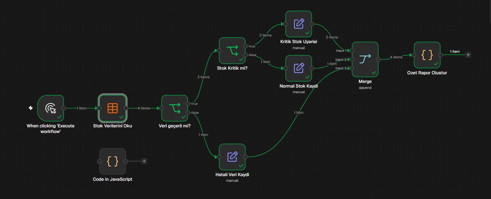
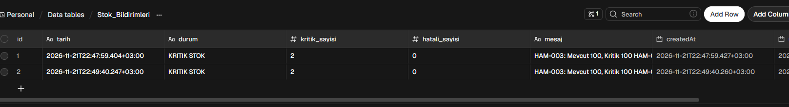
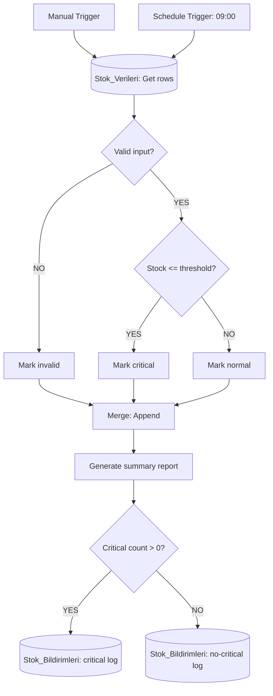

# Stock Monitoring & Critical Stock Alert Workflow

**A learning project built with n8n, JavaScript, and Python as part of a Week 1 study exercise inspired by the Halkbank Data Force training program.**

The project applies algorithmic thinking to a simplified inventory-control problem: read stock records, validate the data, classify each material, create a summary report, and log the outcome to a local n8n data table.

> **Scope:** This is an independently developed educational project, not an official Halkbank system or a deployment connected to production inventory. All sample stock data is fictitious.

## Screenshots

**Workflow execution (core classification and summary):**



**Notification log produced by two manual runs:**



## What it does

1. Starts manually or via a scheduled trigger configured for **09:00** in the workflow.
2. Reads inventory rows from an n8n **Data Table** called `Stok_Verileri`.
3. Checks whether each row contains a non-empty material code and valid, non-negative numeric stock/threshold values.
4. For valid rows, checks whether `mevcut_stok <= kritik_seviye`.
5. Assigns a status of `KRITIK STOK`, `NORMAL STOK`, or `HATALI VERI`.
6. Appends the three outcomes using **Merge**, summarizes counts in a **Code** node, and checks whether any critical stock remains.
7. Inserts one record per workflow run into a second n8n **Data Table** called `Stok_Bildirimleri`, noting whether critical stock was found.

The final step is a **data-table notification log**. It does **not** send an email, push notification, or other external message.

## Workflow overview



Each decision has explicit **YES / NO** paths. The n8n reader processes multiple records as separate items; a Merge node combines the outcomes for reporting.

## Sample data

The included [`data/sample_inventory.csv`](data/sample_inventory.csv) provides the following test case:

| Material | Current stock | Critical threshold | Expected classification |
|---|---:|---:|---|
| HAM-001 | 120 | 200 | Critical |
| HAM-002 | 350 | 150 | Normal |
| HAM-003 | 100 | 100 | Critical (equality is included) |
| HAM-004 | -20 | 100 | Invalid data |

**Expected totals:** 4 materials; **2 critical**, **1 normal**, **1 invalid**. In manual testing, changing stock data updated the report without modifying workflow logic. The zero-critical branch was also manually tested and logged successfully.

## Import & local setup

1. Install and open a supported **n8n** instance (the original project ran locally in Docker).
2. Import [`workflow/stok_kontrol_n8n.json`](workflow/stok_kontrol_n8n.json) using the workflow editor's **Import from file** feature.
3. In your n8n project, create a Data Table named `Stok_Verileri` with these columns:
   - `malzeme_kodu` — **String**
   - `mevcut_stok` — **Number**
   - `kritik_seviye` — **Number**
4. Populate that table with the sample CSV rows (by entering or importing the rows through the n8n interface).
5. Create another Data Table named `Stok_Bildirimleri` with:
   - `tarih` — **String**
   - `durum` — **String**
   - `kritik_sayisi` — **Number**
   - `hatali_sayisi` — **Number**
   - `mesaj` — **String**
6. **Important:** Open all three Data Table nodes (`Stok Verilerini Oku`, `Kritik Stok Bildirimi`, and `Kritik Stok Yok Kaydi`) and **reselect the appropriate table** in their settings. The public JSON deliberately replaces instance-specific table identifiers with placeholders.
7. Confirm that each of the two final Data Table nodes uses **Insert** and that its column mappings match the expected schema. Execute the workflow manually and inspect the report and the `Stok_Bildirimleri` table.
8. Before enabling the 09:00 schedule, verify your workflow or instance **timezone** (for example, `Europe/Istanbul` for Türkiye), then publish/activate the imported workflow when ready.

**Data Table records are not bundled into the workflow JSON.** The CSV in this repository is a separate sample dataset. The public export is **inactive by default** to avoid unexpectedly scheduling jobs after import.

## Python demonstration

The same core decision rules are also shown in a small, standalone Python example:

```bash
python python/stok_kontrol.py
```

It reads `data/sample_inventory.csv` using the Python standard library; no extra packages are required.

## Verified during development

- Manual runs returned the expected **2 critical / 1 normal / 1 invalid** classification for the initial sample dataset.
- Editing material quantities in the n8n Data Table changed the summary output on the next manual run.
- A separate test with **0 invalid** records completed, and a test with **0 critical** records wrote a no-critical log.
- The workflow was published on the local n8n instance.

**Not yet verified:** an unattended 09:00 run, because the local computer and Docker container were powered off during the scheduled windows.

## Limitations / next improvements

- The local **Docker/n8n instance must be running** for scheduled executions; this is not an always-on cloud service.
- Every manual/scheduled run currently creates a new log row. **Deduplication or notification throttling is not implemented.**
- The system logs alerts internally; actual outbound notifications would require an additional integration.
- Fully empty input tables, missing/invalid table references, and some edge cases involving branches with no items have not been validated across all scenarios.
- This is a teaching workflow, not a substitute for a production inventory system with auditing, permissions, data-quality rules, and operational monitoring.

## Repository structure

```text
stock-monitoring-n8n/
├── README.md
├── assets/
│   ├── workflow_execution.png
│   └── notification_log.png
├── workflow/
│   └── stok_kontrol_n8n.json
├── data/
│   └── sample_inventory.csv
└── python/
    └── stok_kontrol.py
```

## Skills practiced

Algorithmic thinking · Input/Process/Output · Decomposition · Pattern recognition · Abstraction · Flowcharts · Pseudocode · Trace tables · Python · Low-code automation · n8n · Conditional branching · Data validation · Reporting
